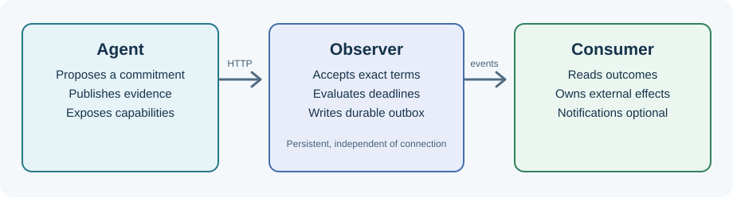

  OPEN PROTOCOL RESEARCH · v0.4.0a2
  
<h1>Vigilact</h1>

  
Declare commitments. Observe evidence. Act with permission.

  <a href="getting-started/five-minute-demo/">Run the HTTP demo</a>
  <a href="concepts/mental-model/">Understand the model</a>

**Vigilact** is a vendor-neutral experiment in negotiated operational contracts. An agent declares the evidence expected before a deadline; an observer persists the agreement, evaluates evidence and publishes a neutral outcome that other software can consume.

<strong>Alpha status.</strong> Reference implementation <code>0.4.0a2</code> advertises protocol profile <code>vigilact/0.1-experimental</code>. This is neither a ratified standard nor a production-hardened observer. APIs and semantics may change.

## Choose your path

  
<h3>Try Vigilact</h3>
Run a real HTTP contract and evidence flow with dynamic deadlines.
<a href="getting-started/five-minute-demo/">Five-minute demo →</a>

  
<h3>Build an integration</h3>
Use Python or JavaScript and consume neutral outcome events.
<a href="guides/backup-integration/">Integration guide →</a>

  
<h3>Review the protocol</h3>
Understand state transitions, failure cases, identity and conformance.
<a href="concepts/evaluation-semantics/">Evaluation model →</a>

## The operating model

1. **Propose:** an authenticated agent submits an `expected_event` commitment.
2. **Accept:** the observer validates and persists the exact terms or rejects them.
3. **Publish:** the agent submits a restricted CloudEvents-style evidence message.
4. **Evaluate:** the observer resolves the commitment as `SATISFIED` or `NOT_OBSERVED`.
5. **Integrate:** downstream consumers decide whether to notify, audit or automate.

## Implemented versus planned

| Included now | Not yet implemented |
| --- | --- |
| One-shot `expected_event` contracts | Cron/recurring observations |
| Receipt-time deadlines and SQLite state | High availability and federation |
| Event idempotency and durable outbox | Full CloudEvents compatibility |
| Agent capability manifests | Capability schemas and negotiation |
| Commands with TTL and explicit uncertain outcomes (disabled by default) | Exactly-once execution and distributed execution guarantees |

An observation marked `NOT_OBSERVED` means **no matching evidence was received by its deadline**; it does *not* prove the operation failed. See [Failure semantics](concepts/failure-semantics.md).

## Learn more

Start with [installation](getting-started/install.md), then read the [HTTP API](protocol/http-api.md), [error catalog](reference/error-catalog.md), [security notes](reference/security.md), and [compatibility policy](reference/compatibility.md).

**Vigilact is not a notification product.** It emits independent evaluation events; it does not send email, SMS, or push notifications. LTG Notify is a separate optional integration, not a dependency.

[Project repository](https://github.com/atellaluca/vigilact) · [Documentation](https://vigilact.atellaluca.com/) · [Apache-2.0 license](https://www.apache.org/licenses/LICENSE-2.0) · [Contributing](reference/contributing.md)

## Verify the engineering claims

See [reproducible engineering evidence](reference/engineering-evidence.md) for cross-language seeded differential testing, transaction failure injection and explicit limits.

## Maintained by

Vigilact is an independent open-source project maintained by **Luca Atella**.
For professional background, questions and collaboration:

- [Technical profile](https://profile.atellaluca.com/)
- [GitHub — @atellaluca](https://github.com/atellaluca)
- [LinkedIn — Luca Atella](https://www.linkedin.com/in/luca-atella/)
- [Email — info@atellaluca.com](mailto:info@atellaluca.com)

See [Project & maintainer](project-and-maintainer.md) for authorship, project scope and contact guidance.
