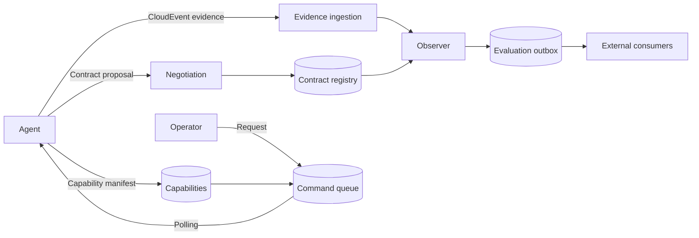

# Architecture & ADR-0001

## Status

**Accepted for alpha implementation**, subject to independent interoperability tests.

## Decision

Keep Vigilact independent from notification systems, orchestration engines and vendor-specific agents. Standardize only observable commitment semantics, event envelopes, capability metadata and authorized command exchange.

## Core concepts

- **Identity / principal** — who is allowed to propose and publish.
- **Contract** — accepted terms, durable independent of network connection.
- **Subject** — the specific resource, process, or job being observed.
- **Evidence** — authenticated event delivered to the observer.
- **Observation** — deterministic rule applied to received evidence.
- **Evaluation** — recorded result such as `SATISFIED` or `NOT_OBSERVED`.
- **Capability** — a declaration of a potential local operation, separate from permission.
- **Command** — a request that is authorized by an operator and explicitly claimed by an agent.

## Reference server modules

`models.py`: transport DTOs with validation. `service.py`: SQLite storage, atomic evaluation logic, outbox and command lifecycle. `server.py`: FastAPI HTTP interface, authentication roles, background reconciliation. `client.py`: optional thin HTTP client. This is a monolithic reference application, not a mandated implementation topology.

## Deliberate trade-offs

| Choice | Benefit | Cost |
| --- | --- | --- |
| One-shot deadlines | Small deterministic semantics | Caller creates a new contract for each occurrence |
| Receipt time rather than event time | Simple spoof-resistant deadline rule | Network outages count as missed evidence |
| SQLite | Demonstrable durability with little infrastructure | No distributed HA / database-level replication |
| Poll-and-claim commands | Works behind NAT and firewalls | Claimed commands can become stranded |
| No automatic execution | Safer trust boundary | Agent must implement its own handler and controls |
| Neutral evaluation outbox | Independent consumers | Consumers must implement cursor persistence |

## Explicit non-goals

- Real-time deterministic control of hardware.
- Exactly-once execution or delivery across distributed failures.
- Arbitrary remote shell execution.
- Notifications, recipient preferences or email/SMS gateways.
- Replacing temporal databases, Prometheus, Kubernetes controllers or Temporal workflows.
- Federated consensus and legally enforceable SLAs.

## Future generalization

The alpha makes the **agent** both proposer and evidence owner. A general protocol should separately identify proposer, subject, evidence producers, observer, authorizer and capability provider. Doing so requires delegated permissions and a reliable cross-party trust model. **This is future work, not a currently supported feature**.
